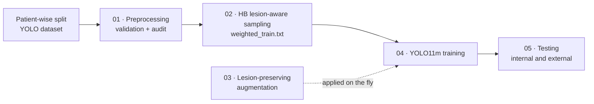

<div align="center">

# CariesLoc-HB

### A Lesion-Preserving Learning Framework for Dental Caries Localization in Intraoral RGB Images

[](https://www.python.org/)
[](https://pytorch.org/)
[](https://github.com/ultralytics/ultralytics)
[](https://docs.ultralytics.com/models/yolo11/)
[](#)
[](LICENSE)

</div>

---

**CariesLoc-HB** is a data-centric framework for localizing dental caries in intraoral RGB photographs with **YOLO11m**. Instead of modifying the detector architecture, it improves *what the model learns from* by combining two ideas:

- **Hard-Background Enhanced Lesion-Aware Sampling** — a capped repeat-sampling scheme that up-weights lesion-free (hard negative) images, minority-class lesions, small lesions and multi-lesion images.
- **Lesion-Preserving Augmentation** — mild colour and geometric transforms that keep tooth appearance and bounding-box alignment intact, with vertical flips, MixUp and Copy-Paste disabled.

The model detects two classes:

| Class ID | Name | Description |
|:--:|---|---|
| `0` | `primary_decay` | Caries in primary (deciduous) teeth |
| `1` | `permanent_decay` | Caries in permanent teeth |

---

## Table of Contents

- [Pipeline](#pipeline)
- [Repository Structure](#repository-structure)
- [Installation](#installation)
- [Dataset Preparation](#dataset-preparation)
- [Usage](#usage)
  - [1. Preprocessing](#1-preprocessing)
  - [2. Hard-Background Lesion-Aware Sampling](#2-hard-background-lesion-aware-sampling)
  - [3. Lesion-Preserving Augmentation](#3-lesion-preserving-augmentation)
  - [4. Training](#4-training)
  - [5. Testing](#5-testing)
- [Training Configuration](#training-configuration)
- [Reproducibility](#reproducibility)
- [Data and Code Availability](#data-and-code-availability)
- [Disclaimer](#disclaimer)
- [Citation](#citation)
- [License](#license)
- [Acknowledgements](#acknowledgements)

---

## Pipeline



| Stage | Script | Purpose |
|:--:|---|---|
| 1 | `01_CariesLoc_Preprocessing.py` | Validates image–label pairs, keeps background images with empty labels, and writes an audit report. No colour or contrast enhancement is applied. |
| 2 | `02_CariesLoc_HB_Lesion_Sampling.py` | Builds a weighted training manifest using capped per-image repeat factors. |
| 3 | `03_CariesLoc_Lesion_Augmentation.py` | Defines the lesion-preserving augmentation settings used during training. |
| 4 | `04_CariesLoc_Training.py` | Trains YOLO11m on the weighted manifest with the augmentation settings. |
| 5 | `05_CariesLoc_Testing.py` | Reports overall and class-wise metrics on a held-out or external dataset using a frozen checkpoint. |

---

## Repository Structure

```text
CariesLoc-HB/
├── 01_CariesLoc_Preprocessing.py         # Stage 1 – dataset validation and audit
├── 02_CariesLoc_HB_Lesion_Sampling.py    # Stage 2 – hard-background lesion-aware sampling
├── 03_CariesLoc_Lesion_Augmentation.py   # Stage 3 – augmentation configuration
├── 04_CariesLoc_Training.py              # Stage 4 – YOLO11m training
├── 05_CariesLoc_Testing.py               # Stage 5 – evaluation
├── requirements.txt
├── LICENSE
├── .gitignore                            # keeps data, runs and weights out of Git
└── README.md
```

> [!NOTE]
> `04_CariesLoc_Training.py` loads `03_CariesLoc_Lesion_Augmentation.py` by file name, so keep both scripts in the same folder.

---

## Installation

```bash
git clone https://github.com/sastikab26/CariesLoc-HB.git
cd CariesLoc-HB

conda create -n CariesLocHB python=3.10 -y
conda activate CariesLocHB
pip install -r requirements.txt
```

Check that PyTorch can see your GPU:

```bash
python -c "import torch; print(torch.__version__, torch.cuda.is_available())"
```

If this prints `False`, install a CUDA-enabled PyTorch build that matches your driver, for example:

```bash
pip install torch==2.3.1 torchvision==0.18.1 --index-url https://download.pytorch.org/whl/cu121
```

<details>
<summary><b>Pinned dependencies</b> (<code>requirements.txt</code>)</summary>

| Package | Version |
|---|---|
| torch | 2.3.1 |
| torchvision | 0.18.1 |
| ultralytics | 8.3.200 |
| opencv-python | 4.10.0.84 |
| Pillow | 10.4.0 |
| numpy | 1.26.4 |
| PyYAML | 6.0.2 |
| matplotlib | 3.9.2 |
| pandas | 2.2.2 |
| scipy | 1.13.1 |
| tqdm | 4.66.5 |

</details>

---

## Dataset Preparation

The scripts expect a dataset that has **already been split patient-wise** (all images of one patient belong to exactly one split) and annotated in YOLO format:

```text
dataset/
├── images/
│   ├── train/
│   ├── valid/        # "val" is also accepted
│   └── test/
└── labels/
    ├── train/
    ├── valid/
    └── test/
```

Each label file has one row per lesion:

```text
<class_id> <x_center> <y_center> <width> <height>
```

- Coordinates are normalized to `[0, 1]` relative to the image size.
- Images with **no** lesions must still have an **empty** `.txt` label file. These background images are kept on purpose and act as hard negatives during training.
- Image and label files are matched by file stem (e.g. `IMG_001.jpg` ↔ `IMG_001.txt`).

> [!IMPORTANT]
> This repository does **not** create patient-wise splits. Do the split yourself before running Stage 1. The preprocessing script flags byte-identical images that appear in more than one split, but that check cannot confirm patient-level separation.

---

## Usage

Run the five stages in order. The paths below are examples; replace them with your own.

### 1. Preprocessing

```bash
python 01_CariesLoc_Preprocessing.py \
    --input-root  /path/to/dataset \
    --output-root /path/to/dataset_validated
```

What it checks:

- every image has a matching label file and there are no orphan labels
- every box has five fields, a valid class ID and lies inside the image
- images are readable and have no unresolved EXIF rotation
- the same image bytes do not appear in two different splits (SHA-256)

Images are copied byte-for-byte when no conversion is needed. No colour, contrast or other photometric enhancement is applied.

| Option | Default | Description |
|---|---|---|
| `--letterbox-size N` | off | Offline square letterboxing to `N × N`, with boxes transformed to match. Leave off to keep original pixels. |
| `--missing-label-is-background` | off | Treat a missing label file as a background image. Use only if your annotation protocol guarantees this. |
| `--invalid-policy {error,drop-box}` | `error` | Stop on malformed boxes (recommended), or drop them and record the count in the audit. |
| `--skip-image-hash-check` | off | Disable the cross-split duplicate-image check. |

**Output**

```text
dataset_validated/
├── images/{train,val,test}/
├── labels/{train,val,test}/
└── audit/
    ├── preprocessing_manifest.csv   # one row per image
    └── preprocessing_summary.json   # per-split counts and settings
```

> The output always uses `val` as the validation folder name, even if the input used `valid`.

### 2. Hard-Background Lesion-Aware Sampling

```bash
python 02_CariesLoc_HB_Lesion_Sampling.py \
    --train-images /path/to/dataset_validated/images/train \
    --train-labels /path/to/dataset_validated/labels/train \
    --val-images   /path/to/dataset_validated/images/val \
    --test-images  /path/to/dataset_validated/images/test \
    --output-dir   runs/sampling
```

Each training image $i$ is assigned four indicators:

| Indicator | Meaning |
|:--:|---|
| $P_i$ | image contains at least one `primary_decay` lesion |
| $M_i$ | image contains at least one `permanent_decay` (minority-class) lesion |
| $S_i$ | the smallest box has normalized area $< \tau_s$ |
| $L_i$ | image contains at least $\lambda$ lesions |

The repeat factor for a lesion-containing image is

$$
R_i = 1 + \alpha M_i + \beta S_i + \gamma M_i S_i + \delta L_i + \mu P_i (1 - M_i),
\qquad
R_i^{*} = \min(R_i,\ R_{\max})
$$

and every background image is repeated $R_{bg}$ times. The image is then listed $R_i^{*}$ times in the weighted manifest. Only the training split is resampled; validation and test are left unchanged.

| Parameter | Symbol | Value |
|---|:--:|:--:|
| Background repeat | $R_{bg}$ | 2 |
| Minority-class weight | $\alpha$ | 2 |
| Small-lesion weight | $\beta$ | 1 |
| Minority × small weight | $\gamma$ | 1 |
| Multi-lesion weight | $\delta$ | 1 |
| Primary-only weight | $\mu$ | 1 |
| Small-lesion area threshold | $\tau_s$ | 0.015 |
| Multi-lesion threshold | $\lambda$ | 3 |
| Maximum repeat factor | $R_{\max}$ | 4 |

**Output**

```text
runs/sampling/
├── weighted_train.txt     # training manifest with repeated image paths
├── sampling_data.yaml     # Ultralytics dataset file used for training
├── sampling_audit.csv     # indicators and repeat factor per image
└── sampling_summary.json  # overall sampling statistics
```

### 3. Lesion-Preserving Augmentation

You do not need to run this script separately; Stage 4 imports it automatically. To view or save the settings:

```bash
# print to the terminal
python 03_CariesLoc_Lesion_Augmentation.py

# save to a file (.json, .yaml or .yml)
python 03_CariesLoc_Lesion_Augmentation.py --output configs/augmentation.yaml
```

| Parameter | Value | Effect |
|---|:--:|---|
| `hsv_h` | 0.010 | very small hue shift |
| `hsv_s` | 0.35 | moderate saturation change |
| `hsv_v` | 0.22 | moderate brightness change |
| `degrees` | 2.5 | small rotation (±2.5°) |
| `translate` | 0.045 | small shift |
| `scale` | 0.18 | scaling of about 0.82–1.18× |
| `shear` | 0.0 | disabled |
| `perspective` | 0.00015 | very slight perspective |
| `fliplr` | 0.5 | horizontal flip |
| `flipud` | **0.0** | **vertical flip disabled** |
| `mosaic` | 0.15 | low mosaic probability |
| `close_mosaic` | 40 | mosaic switched off for the final 40 epochs |
| `mixup` | **0.0** | **disabled** |
| `copy_paste` | **0.0** | **disabled** |
| `erasing` | 0.05 | light random erasing |

The script refuses to run if vertical flip, MixUp or Copy-Paste is set to a non-zero value.

### 4. Training

Check the configuration first without training:

```bash
python 04_CariesLoc_Training.py \
    --data runs/sampling/sampling_data.yaml \
    --output-dir runs/train \
    --dry-run
```

Then train:

```bash
python 04_CariesLoc_Training.py \
    --data runs/sampling/sampling_data.yaml \
    --output-dir runs/train \
    --run-name cariesloc_hb_yolo11m \
    --device 0
```

| Option | Default | Description |
|---|---|---|
| `--data` | required | `sampling_data.yaml` from Stage 2 |
| `--output-dir` | required | folder for checkpoints and logs |
| `--run-name` | `cariesloc_hb_yolo11m` | name of the run folder (must not exist yet) |
| `--device` | `0` | GPU index, `0,1` for multi-GPU, or `cpu` |
| `--dry-run` | off | validate inputs and print settings only |

**Output** — the standard Ultralytics run folder plus a metadata file:

```text
runs/train/cariesloc_hb_yolo11m/
├── weights/
│   ├── best.pt
│   └── last.pt
├── results.csv
├── ...                                   # Ultralytics plots and logs
└── cariesloc_hb_training_metadata.json   # settings, augmentation and environment
```

### 5. Testing

**Internal test set**

```bash
python 05_CariesLoc_Testing.py \
    --weights runs/train/cariesloc_hb_yolo11m/weights/best.pt \
    --data    runs/sampling/sampling_data.yaml \
    --split   test \
    --out     results/internal_test
```

**External dataset** (frozen checkpoint, no fine-tuning)

Create a dataset file such as `external.yaml`. Ultralytics requires `train` and `val` keys, so point them at the external images as well; they are not used for training.

```yaml
path: /path/to/external_dataset
train: images/test   # required by Ultralytics, not used
val: images/test     # required by Ultralytics, not used
test: images/test
names:
  0: primary_decay
  1: permanent_decay
```

```bash
python 05_CariesLoc_Testing.py \
    --weights runs/train/cariesloc_hb_yolo11m/weights/best.pt \
    --data    external.yaml \
    --split   test \
    --dataset-label external \
    --out     results/external_test
```

| Option | Default | Description |
|---|---|---|
| `--weights` | required | trained `.pt` checkpoint |
| `--data` | required | Ultralytics dataset YAML |
| `--split` | `test` | `val` or `test` |
| `--out` | required | output folder for reports and plots |
| `--imgsz` | 1024 | inference image size |
| `--batch` | 4 | batch size |
| `--conf` | 0.001 | minimum confidence used for evaluation |
| `--nms-iou` | 0.50 | IoU threshold for non-maximum suppression |
| `--max-det` | 300 | maximum detections per image |
| `--device` | `0` | GPU index or `cpu` |
| `--dataset-label` | `test` | label written into the report |
| `--save-json` | off | also save predicted detections as JSON |
| `--overwrite` | off | allow writing into a non-empty output folder |
| `--allow-other-classes` | off | skip the two-class name check |

**Reported metrics** — precision, recall, F1-score, mAP@0.5 and mAP@0.5:0.95, both overall and per class.

```text
results/internal_test/
├── evaluation_results.json   # metadata, overall and per-class metrics
├── overall_metrics.csv
├── per_class_metrics.csv
└── ultralytics_validation/   # PR curves, confusion matrix and other plots
```

Evaluation runs without test-time augmentation or retraining.

---

## Training Configuration

| Setting | Value |
|---|---|
| Model | YOLO11m (COCO-pretrained `yolo11m.pt`) |
| Input size | 1024 × 1024 |
| Batch size | 4 |
| Epochs | up to 180 |
| Early-stopping patience | 45 epochs |
| Optimizer | AdamW |
| Initial learning rate (`lr0`) | 3 × 10⁻⁴ |
| Final LR factor (`lrf`) | 0.01 |
| LR schedule | cosine |
| Weight decay | 5 × 10⁻⁴ |
| Momentum | 0.937 |
| Loss gains (box / cls / dfl) | 8.5 / 0.65 / 1.7 |
| Mixed precision (AMP) | enabled |
| Seed | 42 (deterministic mode) |

---

## Reproducibility

- All package versions are pinned in `requirements.txt`.
- Training uses a fixed seed (42) with deterministic mode enabled.
- Each training run saves `cariesloc_hb_training_metadata.json`, which records the full configuration, augmentation settings and software environment (Python, PyTorch, Ultralytics, CUDA and GPU).
- Each evaluation saves its settings and library versions in `evaluation_results.json`.
- Every stage refuses to overwrite existing outputs by default, so earlier results are not replaced by accident.

Results can still vary slightly across GPUs, CUDA versions and driver versions.

---

## Data and Code Availability

The source code is released for research and reproducibility. **Datasets, clinical images and trained checkpoints are not included** in this repository. To reproduce the results reported in the manuscript, use the original patient-wise data partitions and the experiment environment described above.

---

## Disclaimer

CariesLoc-HB is a **research tool**. It is not a medical device and has not been approved for clinical diagnosis. Its outputs must not replace examination by a qualified dental professional.

---

## Citation

If you use this code in your research, please cite the associated manuscript. Full citation details will be added here once the paper is published.

---

## License

This project is released under the [MIT License](LICENSE). The license covers the source code only; it does not grant any rights to clinical data, which is not distributed here.

---

## Acknowledgements

This work builds on [Ultralytics YOLO](https://github.com/ultralytics/ultralytics) and [PyTorch](https://pytorch.org/).
